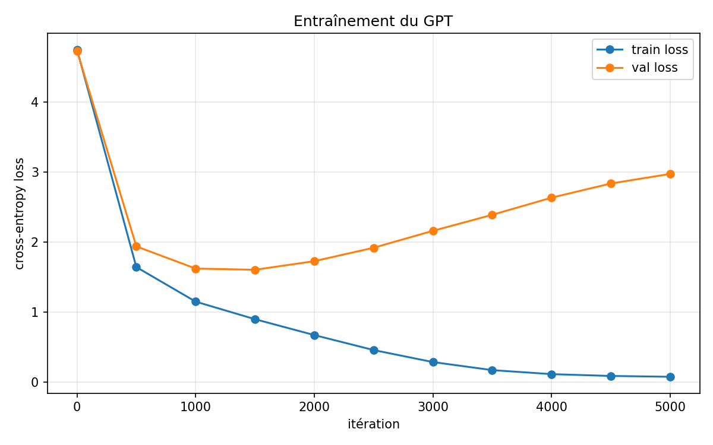

# GPT from scratch

A character-level GPT (decoder-only Transformer) built from scratch in PyTorch, following Andrej Karpathy's lecture
[*Let's build GPT: from scratch, in code, spelled out*](https://www.youtube.com/watch?v=kCc8FmEb1nY).

The model is trained on **[TEXT / AUTHOR]** and learns to generate new text in the same style, one character at a time.

## What's inside

| File | Description |
|---|---|
| `gpt_colab.py` | Full model + training loop (runs on Google Colab with a GPU) |
| `NOTIONS.md` | Detailed notes (in French) explaining every concept used: tokens, tensors, self-attention, multi-head, LayerNorm, residual connections… |
| `loss_curve.png` | Train / validation loss during training |
| `sample_output.txt` | Text generated by the trained model |
| `requirements.txt` | Python dependencies |

## Model architecture

```
characters → token embedding + position embedding
           → 6 × Transformer block
                 ├─ masked multi-head self-attention (6 heads)
                 └─ feed-forward network
                 (pre-LayerNorm + residual connections + dropout)
           → final LayerNorm → linear head → next-character probabilities
```

| Hyperparameter | Value |
|---|---|
| Context length (`block_size`) | 256 characters |
| Embedding size (`n_embd`) | 384 |
| Attention heads (`n_head`) | 6 |
| Transformer blocks (`n_layer`) | 6 |
| Dropout | 0.2 |
| Parameters | ~10.8 M |
| Optimizer | AdamW, lr = 3e-4 |
| Training | 5,000 iterations, batch size 64 |

## Dataset

- **Source:** [BOOK TITLE(S)] by [AUTHOR], from [Project Gutenberg](https://www.gutenberg.org) (public domain)
- **Size:** [N] characters, vocabulary of [N] unique characters
- **Split:** 90 % train / 10 % validation
- **Tokenizer:** character-level (1 character = 1 token)

## Results


| | Loss |
|---|---|
| Before training (random guess) | ~[ln(vocab_size)] |
| Final train loss | [X.XX] |
| Final validation loss | [X.XX] |

**Sample output:**

```
[paste a few lines from sample_output.txt here]
```

## How to run

1. Open `gpt_colab.py` in [Google Colab](https://colab.research.google.com).
2. Enable the GPU: *Runtime → Change runtime type → T4 GPU*.
3. Put `input.txt` in your Google Drive and set `PROJECT_DIR` at the top of the script.
4. Run. Training takes about 15–20 minutes on a T4 GPU.

To run locally instead:
```bash
pip install -r requirements.txt
```
then remove the two Google Drive lines at the top of the script and point `PROJECT_DIR` to your folder.

## What I learned

- How text is turned into tokens and batches of `(context → next token)` training examples
- Why self-attention works: queries, keys, values, scaling and causal masking
- How a Transformer block is built: multi-head attention, feed-forward, residual connections, LayerNorm
- The difference between encoder / decoder and self / cross attention
- Training and evaluating a language model (cross-entropy, train vs validation loss, overfitting)

## Credits

Based on Andrej Karpathy's [Neural Networks: Zero to Hero](https://karpathy.ai/zero-to-hero.html) series
and the [ng-video-lecture](https://github.com/karpathy/ng-video-lecture) repository.
